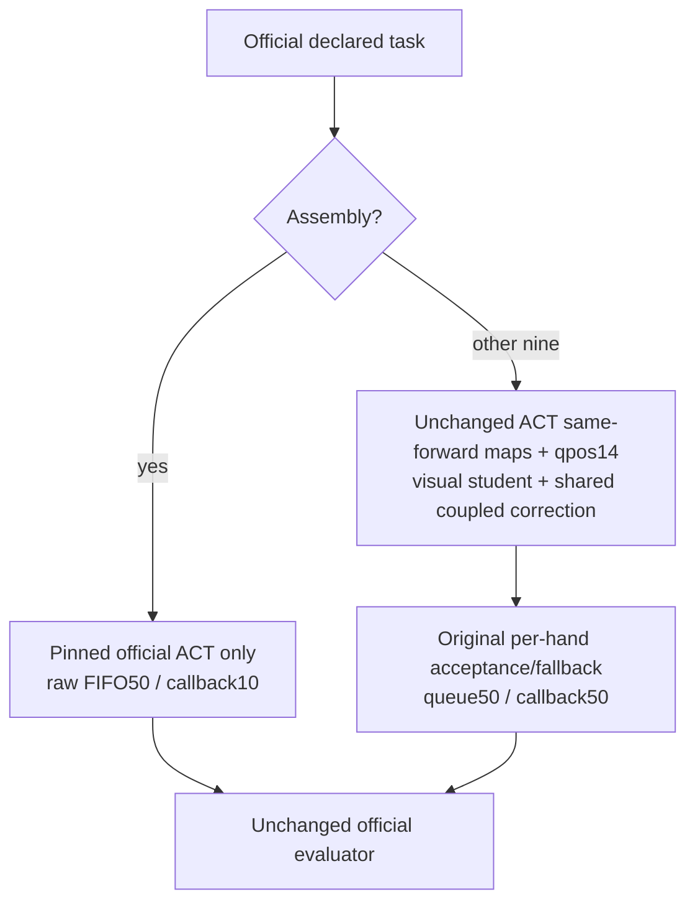
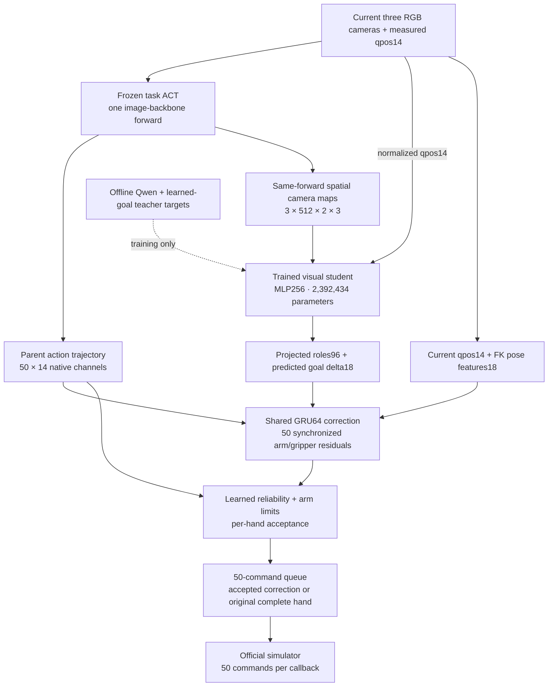

# Compact ACT policy with conservative Assembly fallback for RoboSyn 2026

## Evaluation packaging correction — October 22, 2026

The submitted policy is **`compact_current_ACT_student50_assembly_fallback_v1`**. Copy the complete `policy/compact_current_ACT_student50_assembly_fallback_v1/` directory into the organizer's official evaluation checkout. Every participant runtime dependency, the local setup script, and the byte-preserving source inventory now live inside that directory; no repository-root `experiments/`, `release/`, or `setup.sh` is required after preparation. It is the only immediate policy directory in this correction, avoiding selection of a historical adapter.

From the **official evaluation checkout root**, use its prepared Python environment:

```bash
PYTHON_BIN=/path/to/official/python bash policy/compact_current_ACT_student50_assembly_fallback_v1/setup.sh \
  --download-only --root /tmp/rscp-policy \
  --revision a164024eacdfb66ffdc3a2e3bbaad2bd5d5f46f8
export ROBOSYN_STUDENT50_PACKAGE_ROOT=/tmp/rscp-policy
export PYTHON_BIN=/path/to/official/python
bash policy/compact_current_ACT_student50_assembly_fallback_v1/eval.sh \
  --task click_bell --seed 123 --episodes 20 --output /tmp/robosyn-bell-run
```

The artifact downloader requires CPython 3.11; set `PYTHON311=/path/to/python3.11` separately if the organizer's evaluation interpreter differs. `--download-only` verifies the unchanged checkpoint/source/assets package and leaves the organizer's installed dependencies intact. The evaluator is `scripts/eval_policy.py` in the official checkout, executed by `PYTHON_BIN`; an alternative official location can be supplied with `ROBOSYN_EVALUATOR_ROOT` or `--evaluator-root`. No archived interpreter or simulator bootstrap is substituted in this mode. The exact pinned LeRobot ACT implementation is loaded from the downloaded artifact's `upstream/lerobot-sim/src` to preserve the submitted actor source; installed dependencies still come from the organizer environment. A preexisting incompatible imported ACT module is rejected explicitly. The policy accepts the documented named task, seed, episode-count, and output arguments.

This correction changes packaging and launch paths. All 279 files copied from code commit `91fa5837ef6db239046167e1a5331bf947ec7521` retain their exact bytes. Two additional original metadata files supply a missing task-order import used by the runtime cache helper; they do not alter an actor. The scientific adapter, nine student routes, Assembly ACT-only route, shared trained checkpoints, ten task checkpoints, and immutable HF revision are unchanged. The packaging checks do not constitute a new native rollout or a performance claim.

For a separate standalone reproduction, run the policy-local setup without `--download-only` to create the frozen artifact environment, then pass `--standalone` to `eval.sh`. Only this explicit mode uses the archived evaluator and installed artifact environment.


This is a separate adaptive candidate. For `item_assembly`, it uses the exact pinned released official ACT checkpoint directly, with its raw 50-command FIFO and a ten-command SDK callback. It constructs no visual student or recurrent correction for that task, applies no action transformation, and delegates evaluation and reset to the original official ACT hooks. The other nine tasks retain the same trained current-feature visual student, shared coupled motor, task ACT checkpoints and per-hand fallback as the earlier release. Qwen remains an offline teacher; no language/subtask planner or external inference service runs at deployment.

**Candidate integration status: COMPLETE — 3/10 successes.** All ten new gen31 episodes have genuine native/evaluator exits zero and natural recorded drains, one episode per task at its official full horizon. This confirms the changed adapter runs across all ten tasks; a ten-case screen does not establish organizer leaderboard performance, statistical superiority, or architectural novelty. The separate gen30 Assembly integration test completed six episodes (three per route): candidate 2/3 versus plain ACT 2/3. All three accepted scene/protocol pairs aligned. Both branches use the same released ACT weights, so this tests integration/control agreement, not learned correction efficacy or all-ten superiority. The all-ten immutable HF checkpoints remain at revision `a164024eacdfb66ffdc3a2e3bbaad2bd5d5f46f8`. Publication and submission are separate ROOT actions.

The Assembly route was chosen after observing the original candidate's Assembly result during fixed cohort28. This is an adaptive task-specific change, not the originally preregistered all-task policy. The original fixed gen28+gen29 60-pair outcomes remain attributed to the unchanged original student policy and must never be relabeled or pooled as results of this fallback candidate. The previous protected gen27 result remains 17/30 versus 13/30, p=.109375, FAILED at the preset .10 threshold. The earlier fresh installed screen remains 4/10 for the original policy, including Basket and Water regressions; it is reference evidence, not a measured score of this changed candidate.

## Candidate task routing

| Tasks | Model path | Queue and callback | Candidate validation |
|---|---|---|---|
| `item_assembly` | Pinned released official ACT only; exact raw native channels; student and correction bypassed | Generated/executed FIFO50, callback10 | Fresh gen31 native complete; gen30 all6 complete |
| Other nine official tasks | Original frozen task ACT + trained visual student + coupled residual/reliability tail | Generated/executed50, model callback50 | Source delegation preserved; fresh gen31 native complete |

The routing reads only the declared task identifier. It never selects a branch using scene seed, outcome, hidden state, confidence, future observations, or a demonstration phase. The immutable original Assembly student template is verified as provenance without changing its registered mode or admission. A new raw ACT model is then constructed from its exact checkpoint/config.



## Fresh all-ten screen of this changed candidate

**Candidate integration status: COMPLETE — 3/10 successes.** All ten new gen31 episodes have genuine native/evaluator exits zero and natural recorded drains, one episode per task at its official full horizon. This confirms the changed adapter runs across all ten tasks; a ten-case screen does not establish organizer leaderboard performance, statistical superiority, or architectural novelty. The separate gen30 Assembly integration test completed six episodes (three per route): candidate 2/3 versus plain ACT 2/3. All three accepted scene/protocol pairs aligned. Both branches use the same released ACT weights, so this tests integration/control agreement, not learned correction efficacy or all-ten superiority. The all-ten immutable HF checkpoints remain at revision `a164024eacdfb66ffdc3a2e3bbaad2bd5d5f46f8`. Publication and submission are separate ROOT actions.

Generator2026103101, motor17, one episode per task, generated/executed50. Assembly uses raw official ACT and callback10; the other nine tasks keep the original student and coupled correction with callback50. This is a new adaptive task-routing candidate. None of the earlier original-policy scores are assigned to it. No new contemporaneous all-ten baseline was run. Accepted seed identity does not prove bitwise equality of initial RGB or hidden physical states.

| Task | Candidate success | Actual episodes | Action steps / official horizon | Motor seed | SDK callback |
|---|---:|---:|---:|---:|---:|
| `table_rearrangement` | 1/1 | 1 | 127 / 361 | 17 | 50 |
| `click_bell` | 0/1 | 1 | 361 / 361 | 17 | 50 |
| `water_pouring` | 0/1 | 1 | 500 / 500 | 17 | 50 |
| `handle_basket` | 0/1 | 1 | 500 / 500 | 17 | 50 |
| `items_handover` | 0/1 | 1 | 350 / 350 | 17 | 50 |
| `drawer_open_place` | 0/1 | 1 | 900 / 900 | 17 | 50 |
| `mixer_operating` | 1/1 | 1 | 246 / 500 | 17 | 50 |
| `item_assembly` | 0/1 | 1 | 500 / 500 | 17 | 10 |
| `manipulate_pipette` | 1/1 | 1 | 238 / 1000 | 17 | 50 |
| `sample_loading` | 0/1 | 1 | 500 / 500 | 17 | 50 |

## Original method: fixed sixty-pair reference only

The unchanged original student method completed the fixed gen28+gen29 cohort at 31/60 versus 28/60 plain ACT, 10 student-only wins and 7 ACT-only wins, one-sided exact McNemar p=0.314529418945. Its predeclared net>=6 and p<=.10 criterion FAILED. These 120 episodes were generated by the original method, before this adaptive Assembly route. They are not this candidate's results, are not pooled with gen30/gen31, and do not validate its task-specific change. The separate gen27 result remains17/30 versus13/30, p=.109375, FAILED; the original fresh installed screen remains4/10 with Basket and Water regressions.

## Earlier original-policy evidence (not this candidate)

## Fresh installed all-ten-task integration screen of the original policy

One current short-root episode per task; accepted seed/candidate/attempt/expert metadata match the earlier gen24 screen. Exact initial RGB, object-state and command equality are not established. Historical organizer 100-case percentages are a different protocol and are not inferred from these results.

| Task | Fresh installed compact | Earlier compact50 gen24 | Plain ACT50 gen24 | Official horizon |
|---|---:|---:|---:|---:|
| `table_rearrangement` | 1/1 (127 actions) | 1/1 | 1/1 | 361 |
| `click_bell` | 0/1 (361 actions) | 0/1 | 0/1 | 361 |
| `water_pouring` | 0/1 (500 actions) | 1/1 | 0/1 | 500 |
| `handle_basket` | 0/1 (500 actions) | 1/1 | 1/1 | 500 |
| `items_handover` | 1/1 (314 actions) | 1/1 | 0/1 | 350 |
| `drawer_open_place` | 1/1 (375 actions) | 1/1 | 0/1 | 900 |
| `mixer_operating` | 0/1 (500 actions) | 0/1 | 0/1 | 500 |
| `item_assembly` | 0/1 (500 actions) | 0/1 | 0/1 | 500 |
| `manipulate_pipette` | 1/1 (236 actions) | 1/1 | 1/1 | 1000 |
| `sample_loading` | 0/1 (500 actions) | 0/1 | 0/1 | 500 |

Fresh score: **4/10**. Earlier selected compact50: **6/10**; plain ACT50: **3/10**. These same-scene identities are useful comparison metadata, not a guarantee of exact replay.

Basket regression is preserved: the earlier compact rollout succeeds at 331 actions; the fresh rollout times out at 500. Saved frames show both bringing the bottle into the basket, then the fresh rollout carrying it back out during withdrawal and leaving it on the table. Initial camera buffers and the first seven command hashes differ; the opening/contact trajectory was not saved. Both use eager correction. The precise cause remains unproved, and this case is not relabeled as an unavailable episode.

Water pouring also regresses from the earlier compact result of 1/1 to a fresh result of 0/1 at the full 500-action timeout. These two observed regressions reduce the fresh screen from the earlier 6/10 to 4/10. A specific cause for Water's change has not been established. The earlier plain ACT50 score of 3/10 is retained as reference, not a new contemporaneous baseline evaluation or proof of a public benchmark gain.

## Unchanged student architecture used on the other nine tasks

On the nine student-routed tasks, the deployed model remains a **goal-conditioned ACT residual policy**. It predicts a compact continuous role/goal representation from the current observations and uses that representation to correct the ACT action trajectory. It has no text-generating planner, discrete subtask planner, or online Qwen call. The official task identifier selects its released ACT checkpoint, and the supplied instruction is validated against that task. ACT itself does not become language-conditioned through this wrapper.



The student flattens the three normalized spatial feature maps and concatenates measured joint state. Its two heads predict 96 projected role values and an 18-value normalized goal delta. The recurrent motor also receives current forward-kinematics features and the parent ACT trajectory. It generates residuals for all 14 channels: six arm joints and one gripper per hand. Arm residuals use radians; gripper residuals use physical opening metres before the task-specific inverse conversion. A rejected hand retains all seven original native ACT channels exactly; accepting the two hands separately can produce mixed acceptance and does not establish improved bimanual coordination.

| Component | Training and deployment status | Runtime role |
|---|---|---|
| Ten task ACT checkpoints and image backbone | Released checkpoints; frozen in our adaptation | Current visual features and parent 50-command trajectory |
| Visual student: 2,392,434 parameters | Trained on competition FIT current-observation features and offline teacher targets | Predicts roles96 and goal delta18 from the same ACT backbone pass and qpos14 |
| Shared coupled motor checkpoint: 180,528 parameters | Trained earlier on competition FIT arm/gripper trajectories; frozen while fitting the selected visual student | GRU64 trajectory correction and learned per-hand reliability |
| Active projected-input motor tail: 49,424 parameters | Subset of the stored motor checkpoint | Actual recurrent/action/reliability path used at deployment |
| Teacher-role projection: 131,104 parameters | Stored in that checkpoint; bypassed by the projected-input runtime | Not executed by this release |
| Qwen foundation observer and goal targets | Used offline during target construction; absent from the deployed payload | No inference-time calls or model allocation |

There is no second image-backbone pass, no future observation, and no hidden simulator state in the deployed interface. These trained components provide a concrete architecture change; the measured 17/30 versus 13/30 comparison does not by itself prove architectural novelty, a foundation-model contribution, or statistical benchmark superiority. The frozen selected release is distinct from later joint-training experiments.

## Required files and environment

The new candidate organizer-facing adapter is `policy/compact_current_ACT_student50_assembly_fallback_v1/`:

- `eval.sh`
- `deploy_policy.yml`
- `deploy_policy.py`, exporting `get_model`, `eval`, `reset_model`, and `close_model`

Use Linux x86_64, **CPython 3.11**, and an NVIDIA GPU/driver compatible with the included Torch CUDA wheels. The intended competition device is one RTX 5090 32GB; direct RTX 5090 qualification is pending. The full package pins the simulator, evaluator, LeRobot and all Python dependencies in `requirements/sim.lock`, and includes 282 offline distributions. Native Linux libraries include `libGLU.so.1`, `libGL.so.1`, and `libgomp.so.1` (Ubuntu packages `libglu1-mesa`, `libgl1`, and `libgomp1`).

The artifact is about 9.01GB, including about 2.08GB of model assets. Allow at least 32GiB free disk before download/install. No models, datasets, credentials, or generated environments are stored in this GitHub repository. The immutable Hugging Face package preserves the exact source, simulator assets, dependency wheels, checkpoint metadata and path-alias closure verified during preparation. Historical metadata inside that immutable package is validation provenance, not an additional training-data download.

## Setup and evaluate

Setup defaults to the exact uploaded 40-character revision below. All ten checkpoint paths have passed anonymous access checks. Use a short ordinary absolute installation path, such as `/tmp/rscp-policy`, for the native simulator. A byte-identical installed package and environment under a short ordinary root completed the Bell runtime smoke described above; all ten fresh native tasks completed as detailed above; direct RTX 5090 qualification remains pending.

```bash
bash policy/compact_current_ACT_student50_assembly_fallback_v1/setup.sh --download-only --root /tmp/rscp-policy \
  --revision a164024eacdfb66ffdc3a2e3bbaad2bd5d5f46f8
export ROBOSYN_STUDENT50_PACKAGE_ROOT=/tmp/rscp-policy
export PYTHON_BIN=/path/to/official/python
bash policy/compact_current_ACT_student50_assembly_fallback_v1/eval.sh \
  --task click_bell --seed 123 --episodes 20 --output /tmp/robosyn-bell-run
```

Download-only setup downloads and verifies the SHA-bound immutable package while retaining the organizer's existing evaluation environment. Forty-five archived Git-LFS pointer-text fixtures are transported as pinned base64 JSON and restored to their exact original bytes before verification; no pointed-to datasets or test artifacts are downloaded. `PYTHON311` selects the CPython 3.11 downloader. For standalone historical reproduction only, omit `--download-only`: this invokes the pinned offline install recipe, creates `<installation-root>/.venvs/sim`, validates its versions, and installs the archived task-import routing repair. Use that interpreter with the explicit `--standalone` launch mode. A failed/incomplete installation must be inspected before another install; setup never substitutes a different dependency lock.

Keep the installation root short and ordinary: do not replace it with a symlink into a deep checkout. The simulator loads task assets and native libraries from installed absolute paths. CPU configuration and module checks passed for a complete byte-identical package and environment under a short root. The original policy completed its Bell rollout and all-ten fresh native screen described above. That integration evidence is reference only for the changed Assembly-fallback candidate; its separate gen31 native proofs are complete as described above. `/tmp` may be cleared by a reboot, so a persistent short root such as `/opt/rscp-policy` is also suitable when writable.

For each new evaluation, pass the organizer's generator seed, episode count and a fresh output directory. A local metadata binder derives the installed paths automatically after full byte verification. It requires no team token, root session, or manual approval. The team token is used only in the official submission portal. The actor and action code remain unchanged. Byte verification adds constructor startup time; it is outside steady inference.

In the official evaluation checkout, the shell invokes the retained policy-local `deploy_policy.yml` through the organizer's `scripts/eval_policy.py` and imports the retained policy-local `deploy_policy.py` four hooks. The command preserves the official full task horizon. The organizer can also import `policy.compact_current_ACT_student50_assembly_fallback_v1.deploy_policy` and pass the official task arguments to the four hooks; `ROBOSYN_STUDENT50_PACKAGE_ROOT` selects the downloaded artifact directory. For the nine student-routed tasks, the actor maintains its own 50-command queue, sets `model.act_step=50` and returns 50 commands per SDK callback. For Assembly, the exact released official ACT FIFO generates and executes 50 commands across ten-command SDK callbacks. The task-specific shell passes --act_step10 for Assembly and --act_step50 otherwise. This is a complete-method comparison, not a correction-only ablation.

## Checkpoints and all-ten-task commands

The nine student-routed tasks share `models/current-student/distill_visual.pt` and `models/frozen-coupled-role/coupled-all14.safetensors`. Assembly loads only its released ACT checkpoint; it does not instantiate these two shared models. Every task loads the same released ACT checkpoint files as the prior artifact. The immutable checkpoint paths and horizons are in [task-checkpoints.json](task-checkpoints.json). Its `run_command` entries use the Assembly-fallback adapter shown below. The selected artifact manifest SHA256 is `191e3a69625175b96c685304e19d5362522e16338943cd6c3065448cabb89515`.

| Task | ACT checkpoint at pinned HF revision | Horizon | Run command (organizer supplies seed/count) |
|---|---|---:|---|
| Table rearrangement (`table_rearrangement`) | [models/act/table_rearrangement](https://huggingface.co/0x00ff00ff/robosyn-2026-compact-act-policy/tree/a164024eacdfb66ffdc3a2e3bbaad2bd5d5f46f8/models/act/table_rearrangement) | 361 | `bash policy/compact_current_ACT_student50_assembly_fallback_v1/eval.sh --task table_rearrangement --seed ORGANIZER_SEED --episodes ORGANIZER_COUNT --output /tmp/robosyn-table_rearrangement` |
| Click bell (`click_bell`) | [models/act/click_bell](https://huggingface.co/0x00ff00ff/robosyn-2026-compact-act-policy/tree/a164024eacdfb66ffdc3a2e3bbaad2bd5d5f46f8/models/act/click_bell) | 361 | `bash policy/compact_current_ACT_student50_assembly_fallback_v1/eval.sh --task click_bell --seed ORGANIZER_SEED --episodes ORGANIZER_COUNT --output /tmp/robosyn-click_bell` |
| Water pouring (`water_pouring`) | [models/act/water_pouring](https://huggingface.co/0x00ff00ff/robosyn-2026-compact-act-policy/tree/a164024eacdfb66ffdc3a2e3bbaad2bd5d5f46f8/models/act/water_pouring) | 500 | `bash policy/compact_current_ACT_student50_assembly_fallback_v1/eval.sh --task water_pouring --seed ORGANIZER_SEED --episodes ORGANIZER_COUNT --output /tmp/robosyn-water_pouring` |
| Handle basket (`handle_basket`) | [models/act/handle_basket](https://huggingface.co/0x00ff00ff/robosyn-2026-compact-act-policy/tree/a164024eacdfb66ffdc3a2e3bbaad2bd5d5f46f8/models/act/handle_basket) | 500 | `bash policy/compact_current_ACT_student50_assembly_fallback_v1/eval.sh --task handle_basket --seed ORGANIZER_SEED --episodes ORGANIZER_COUNT --output /tmp/robosyn-handle_basket` |
| Items handover (`items_handover`) | [models/act/items_handover](https://huggingface.co/0x00ff00ff/robosyn-2026-compact-act-policy/tree/a164024eacdfb66ffdc3a2e3bbaad2bd5d5f46f8/models/act/items_handover) | 350 | `bash policy/compact_current_ACT_student50_assembly_fallback_v1/eval.sh --task items_handover --seed ORGANIZER_SEED --episodes ORGANIZER_COUNT --output /tmp/robosyn-items_handover` |
| Drawer open place (`drawer_open_place`) | [models/act/drawer_open_place](https://huggingface.co/0x00ff00ff/robosyn-2026-compact-act-policy/tree/a164024eacdfb66ffdc3a2e3bbaad2bd5d5f46f8/models/act/drawer_open_place) | 900 | `bash policy/compact_current_ACT_student50_assembly_fallback_v1/eval.sh --task drawer_open_place --seed ORGANIZER_SEED --episodes ORGANIZER_COUNT --output /tmp/robosyn-drawer_open_place` |
| Mixer operating (`mixer_operating`) | [models/act/mixer_operating](https://huggingface.co/0x00ff00ff/robosyn-2026-compact-act-policy/tree/a164024eacdfb66ffdc3a2e3bbaad2bd5d5f46f8/models/act/mixer_operating) | 500 | `bash policy/compact_current_ACT_student50_assembly_fallback_v1/eval.sh --task mixer_operating --seed ORGANIZER_SEED --episodes ORGANIZER_COUNT --output /tmp/robosyn-mixer_operating` |
| Item assembly (`item_assembly`) | [models/act/item_assembly](https://huggingface.co/0x00ff00ff/robosyn-2026-compact-act-policy/tree/a164024eacdfb66ffdc3a2e3bbaad2bd5d5f46f8/models/act/item_assembly) | 500 | `bash policy/compact_current_ACT_student50_assembly_fallback_v1/eval.sh --task item_assembly --seed ORGANIZER_SEED --episodes ORGANIZER_COUNT --output /tmp/robosyn-item_assembly` |
| Manipulate pipette (`manipulate_pipette`) | [models/act/manipulate_pipette](https://huggingface.co/0x00ff00ff/robosyn-2026-compact-act-policy/tree/a164024eacdfb66ffdc3a2e3bbaad2bd5d5f46f8/models/act/manipulate_pipette) | 1000 | `bash policy/compact_current_ACT_student50_assembly_fallback_v1/eval.sh --task manipulate_pipette --seed ORGANIZER_SEED --episodes ORGANIZER_COUNT --output /tmp/robosyn-manipulate_pipette` |
| Sample loading (`sample_loading`) | [models/act/sample_loading](https://huggingface.co/0x00ff00ff/robosyn-2026-compact-act-policy/tree/a164024eacdfb66ffdc3a2e3bbaad2bd5d5f46f8/models/act/sample_loading) | 500 | `bash policy/compact_current_ACT_student50_assembly_fallback_v1/eval.sh --task sample_loading --seed ORGANIZER_SEED --episodes ORGANIZER_COUNT --output /tmp/robosyn-sample_loading` |

Use the same command above with `--task` set to each table row. Seeds and episode counts are supplied by the organizer, not selected by the policy.

## Training and validation scope

Training uses the competition's provided demonstrations. The coupled correction uses the existing FIT current-observation/ACT-action caches; the visual student is fitted to offline teacher targets using current images and joint positions. Future demonstration actions are training labels only. At inference, no future frames, demonstration identifiers, hidden simulator state, or outcome labels are provided. The ACT backbone and task checkpoints are retained; this release does not claim a newly pretrained foundation model or a high-level text-generating planner.

The immutable package includes upstream source components used by the deployment; their existing licenses and notices apply. This repository contains the corresponding unchanged source files plus the automatic release binder and installer wrapper. It does not claim that every historical experiment or archived model was successful.
